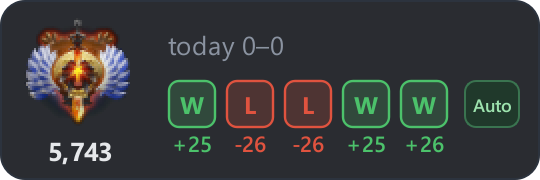
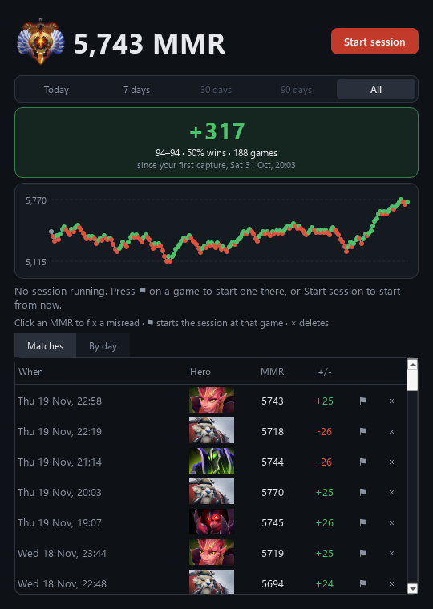
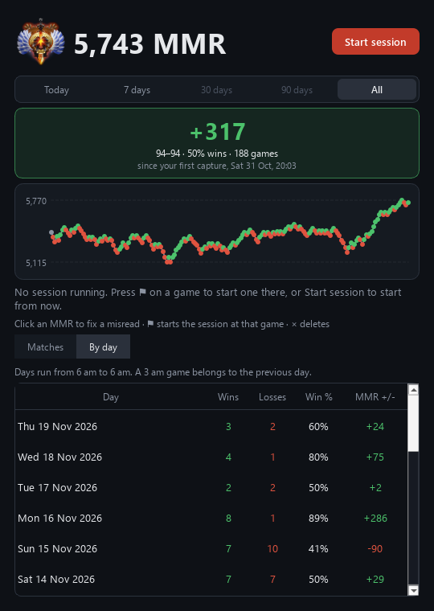

# Dota 2 Ranked Tracker

A small always-on-top widget for Dota 2 ranked. It shows your medal and MMR, your last 5 games as W/L boxes with the **MMR +/- of each one**, and your session total. It reads your MMR straight off Dota's screen, so you see the change the moment you open your profile, with no waiting for Dota Plus.



## Download

Get `DotaRankTracker.exe` from the [latest release](../../releases/latest) and run it. No install and no account needed. If you're upgrading, quit the old copy from the tray first and replace the executable your shortcut points to.

Windows may say "Windows protected your PC" because the exe isn't signed. Click **More info → Run anyway**.

Play Dota in **Borderless Window** mode. Overlays can't show on top of exclusive fullscreen.

To check which build is running, right-click the tray icon: the menu header shows the version. It also appears when hovering over the tray icon and in the History window title.

## What's new in v0.4.3

- **Auto** sits beside the W/L boxes without making the overlay taller. Green means after-match capture is on; gray means it's off. Turn it off before Turbo to prevent the tracker from opening History after a match.
- **History → By day** shows wins, losses, win rate, and MMR change, with a 6 am cutoff for late-night games.
- Captures more than **100 MMR** from the last saved value are rejected. Failed automatic reads retry after a short cooldown, and OCR errors are logged.

## Setup (once)

1. In Dota, open your profile's **History** page. Your MMR is in the top right, your medal left of your name.
2. Press **Ctrl+Shift+E**. Drag a box around the MMR number, then a box around your medal. The widget shows both right away.
3. Press **Ctrl+Shift+D** once to teach it the way to History: click the **Dota logo** (top left), then **your profile**, then **History**, and press **Ctrl+Shift+D** again to save.
4. In Steam, right-click **Dota 2 → Properties** and add `-gamestateintegration` to the launch options (then restart Dota). This lets the tracker see when a game starts and ends. The app puts the small settings file Dota needs into Dota's folder by itself.

## Every game after that

Nothing to press. Once the hero picks are done, the widget hides for the match. When the Ancient falls it waits 10 seconds, shows the widget again, and (once you're back in Dota's menu) goes to your History page and captures your MMR. The game's hero shows as a portrait next to that +/- in the history (each portrait is downloaded once from Valve's image server, then kept; offline you see the name).

Dota's local game feed doesn't reliably distinguish ranked from Turbo. Before playing Turbo, click **Auto** on the floating widget to turn it gray and stop it from opening History after matches. Green means it's on. The widget remembers your choice; manual captures and passive reads when you open History yourself still work.

You can also press **Ctrl+Shift+D** any time. It clicks its way to your History page and captures your MMR in about 1 second (your medal a moment later). Already on History? It also spots a new MMR by itself, or press **Ctrl+Shift+E**. You never type or confirm anything.

It really clicks those spots, so it checks first: if the spot of your first click doesn't look like the Dota logo did when you recorded (say you're in a match), it does nothing and the widget says "not in menus".

Every MMR change counts as one game: + is a **W**, − is an **L**. If you skip capturing between two games, they show as one combined box.

**Wrong number?** Click the widget to open the history. Click the number to fix it, or **×** to delete it.

## Controls

| Do this | What happens |
|---|---|
| **Ctrl+Shift+D** | Go to your History page and capture |
| **Ctrl+Shift+E** | Capture your MMR and medal off Dota's screen |
| **Ctrl+Shift+R** | Hide / show the widget |
| **Auto** beside the W/L boxes | Toggle after-match navigation and capture (green = on) |
| **Click** the widget | History: every MMR you captured, fix or delete, mark a session |
| **Drag** the widget | Moves it (position is remembered) |
| **Right-click** the widget or the tray icon | Menu: capture, start/end session, history, set screen areas, re-record the way to History, hotkeys, after-game auto capture on/off, start with Windows, quit |

The three hotkeys are Ctrl+Shift plus a letter; change the letters under right-click → **Hotkeys…** (handy if another app, like Turbo Tracker, already uses one).

## Sessions

- **Start session** (history window or right-click menu) counts every game from now.
- Forgot to start one? In the history, click **⚑** on the first game of your session.
- While a session runs, the widget shows `session 4–1 +76`. Otherwise it shows today's games (since 6 am).
- In the history window, pick a period (**Today, 7 days, 30 days, 90 days or All**): the card shows its MMR +/-, W–L and win %, a graph shows your MMR game by game, and the list shows just those games. A day runs from 6 am to 6 am, so a late-night session counts as that evening. Periods your log doesn't reach back to yet are greyed out.
- Open **By day** in History to see each day's wins, losses, win rate and MMR change, newest first. It follows the selected period and shows days with recorded games. The date is the day the 6 am window starts: a game captured at 3 am Tuesday counts toward Monday, while a game at 6 am Tuesday counts toward Tuesday. Return to **Matches** to fix or delete individual captures.

### Matches



### By day



## Your medal

The widget shows a picture of your medal, taken from Dota's screen each time your MMR is captured, so it's always exactly what Dota shows (stars and all). It's only taken when the MMR read works, so it's never a random bit of a game. It's saved as `%APPDATA%\DotaRankTracker\medal.png`.

## How the MMR reading works

- It reads only the boxes you picked, and only while Dota is the window in front. It waits until that box stops changing (a menu page, not the game itself), so it does nothing during a match.
- Automatic and manual reads after the first capture are accepted only if they are within 100 MMR of your last saved value. The first manual capture establishes your starting MMR; larger changes are rejected as likely misreads.
- Failed or implausible automatic reads are retried after a 15-second cooldown, even if the screen hasn't changed. Successful unchanged reads aren't processed again.
- OCR runtime/model failures show an error and are recorded in `events.log`, separately from an ordinary unreadable number. Repeated identical automatic errors don't keep sending notifications.
- The widget hides itself from screenshots, so it can sit right on top of the number.
- Changed your resolution? Right-click → **Set MMR + medal screen areas…**.
- No game memory, no Steam login, nothing sent anywhere. Your log is in `%APPDATA%\DotaRankTracker\settings.json`, with a copy each day in the `backups` folder next to it (the last 7 days). `events.log` there notes each game start/end and when the widget hides or shows.
- Game start and end come from Dota's own Game State Integration, sent only to your PC (127.0.0.1).

The text reader is [PaddleOCR](https://github.com/PaddlePaddle/PaddleOCR)'s tiny recognition model (Apache-2.0), in the ONNX version from [RapidOCR](https://github.com/RapidAI/RapidOCR), run with onnxruntime. It got 1,000 out of 1,000 test numbers right in Dota's own font, at about 2 ms each.

## Build it yourself

```powershell
pip install -r requirements.txt pyinstaller
python test_rank_overlay.py
.\build.ps1          # -> dist\DotaRankTracker.exe (~59 MB)
```

If your Start menu shortcut points to a copy installed elsewhere, quit the tracker and replace that installed exe with the newly built one too; rebuilding the project alone doesn't update it.

Pushing a version tag such as `v0.4.3` runs the tests, builds the Windows exe on GitHub Actions, and attaches it to the release.
